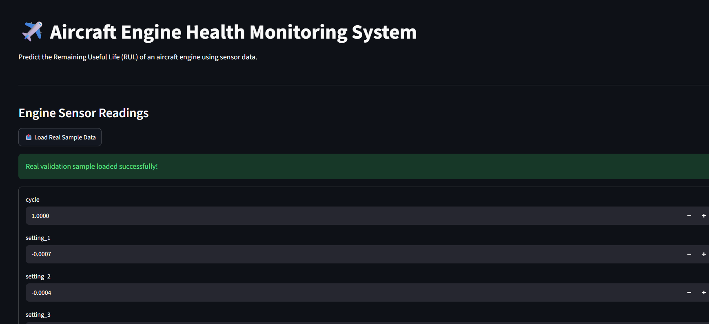
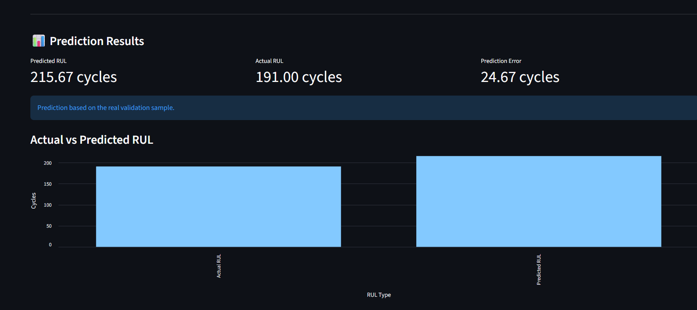

# Aircraft Engine Predictive Maintenance using Machine Learning

Predicting the Remaining Useful Life (RUL) of aircraft turbofan engines using sensor data and Machine Learning.

## Project Overview

Aircraft engines undergo gradual degradation over time due to continuous operation under varying conditions. Predictive maintenance helps monitor engine health and estimate the remaining useful life of an engine before potential failure.

This project uses machine learning regression models to predict the Remaining Useful Life (RUL) of aircraft engines based on operational settings and sensor measurements.

The project includes data cleaning, exploratory data analysis, feature selection, model training, evaluation, and an interactive Streamlit dashboard for RUL prediction.

## Problem Statement

The objective of this project is to predict the Remaining Useful Life (RUL), measured in operating cycles, of aircraft turbofan engines using historical sensor data.

By analyzing engine operating conditions and sensor measurements, machine learning models are trained to estimate how many operating cycles an engine may have remaining.

## Dataset

**Dataset:** NASA C-MAPSS Turbofan Engine Degradation Dataset (FD001)

The dataset contains simulated turbofan engine sensor readings collected over multiple operating cycles as engines gradually degrade.

Dataset information:

- Multiple engine units
- Engine operating cycles
- Operational settings
- Sensor measurements
- Engine-wise degradation history

The raw dataset is not included in this repository.

Dataset source: [NASA Prognostics Data Repository](https://www.nasa.gov/intelligent-systems-division/)

## Exploratory Data Analysis

Exploratory Data Analysis was performed to understand the dataset, identify data quality issues, analyze sensor behaviour, and explore relationships between sensor measurements and engine degradation.

### EDA Activities

- Dataset inspection and statistical analysis
- Missing value analysis
- Duplicate row analysis
- Constant feature identification
- Engine lifetime distribution analysis
- Sensor distribution analysis
- Boxplot and outlier analysis
- Sensor correlation analysis
- Sensor behaviour over operating cycles
- RUL target generation
- Feature selection

### Key Findings

- Six sensors — Sensor 1, 5, 10, 16, 18 and 19 — exhibited constant readings.
- Sensor 9 and Sensor 14 showed a strong positive correlation of approximately 0.96.
- Sensor 11 and Sensor 12 showed a strong negative correlation of approximately -0.85.
- Sensor 20 and Sensor 21 showed a positive correlation of approximately 0.69.
- Sensor 4 and Sensor 11 showed noticeable increases during later operating cycles.
- Sensor readings exhibited different distributions and varying levels of potential outliers.

Outliers were not removed blindly, as they may represent genuine engine operating behaviour.

## RUL Calculation

Remaining Useful Life was calculated using the maximum operating cycle of each engine.

**RUL = Maximum Engine Cycle − Current Operating Cycle**

The target variable represents the number of operating cycles remaining before the end of the recorded engine life.

## Machine Learning Workflow

1. Data loading and inspection
2. Data cleaning
3. Exploratory Data Analysis
4. RUL target generation
5. Removal of constant sensors
6. Feature-target separation
7. Engine-wise train-validation split
8. Model training
9. Model evaluation
10. Best model selection
11. Model serialization
12. Streamlit dashboard development

## Train-Validation Split

To avoid data leakage between engines, an engine-wise split was performed using `GroupShuffleSplit`.

| Parameter | Value |
|---|---|
| Split Method | GroupShuffleSplit |
| Training Percentage | 80% |
| Validation Percentage | 20% |
| Random State | 42 |
| Training Engines | 80 |
| Validation Engines | 20 |
| Training Samples | 16,561 |
| Validation Samples | 4,070 |

This approach ensures that engines assigned to the training set are separated from engines assigned to the validation set.

## Machine Learning Models

The following regression models were trained and evaluated:

- Linear Regression
- Random Forest Regressor
- Gradient Boosting Regressor

### Evaluation Metrics

**Mean Absolute Error (MAE):** Measures the average absolute difference between actual and predicted RUL.

**Root Mean Squared Error (RMSE):** Measures prediction error while penalizing larger errors more strongly.

**R² Score:** Measures how well the model explains the variance in the target variable.

### Model Performance Comparison

| Model | MAE | RMSE | R² Score |
|---|---:|---:|---:|
| Linear Regression | 25.155 | 31.656 | 0.768 |
| Random Forest | 24.086 | 31.758 | 0.766 |
| Gradient Boosting | 22.692 | 29.752 | 0.795 |

### Best Performing Model

**Gradient Boosting Regressor** achieved the best overall performance among the evaluated models.

| Metric | Value |
|---|---:|
| MAE | 22.692 cycles |
| RMSE | 29.752 cycles |
| R² Score | 0.795 |

Based on the validation results, Gradient Boosting was selected as the final model and saved for integration into the Streamlit dashboard.

## Aircraft Engine Health Monitoring Dashboard

An interactive dashboard was developed using Streamlit to predict the Remaining Useful Life of an aircraft engine using sensor inputs.

### Dashboard Features

- Interactive engine sensor inputs
- Load real validation sample
- RUL prediction
- Actual RUL comparison for the validation sample
- Prediction error calculation
- Actual vs Predicted RUL visualization

### Dashboard Screenshots

#### Engine Sensor Readings



#### Prediction Results



### Validation Sample Prediction

| Metric | Value |
|---|---:|
| Predicted RUL | 215.67 cycles |
| Actual RUL | 191.00 cycles |
| Prediction Error | 24.67 cycles |

The dashboard displays the predicted Remaining Useful Life alongside the actual RUL for the loaded validation sample.

The prediction error is calculated as the absolute difference between actual and predicted RUL.

**Absolute Prediction Error = |Actual RUL − Predicted RUL|**

## Project Structure

```text
Aircraft-Engine-Predictive-Maintenance-using-Machine-Learning/
│
├── README.md
├── requirements.txt
├── .gitignore
│
├── data/
│   └── README.md
│
├── notebooks/
│   └── 01_EDA.ipynb
│
├── models/
│   ├── best_rul_model.pkl
│   └── feature_columns.pkl
│
├── app/
│   └── app.py
│
└── screenshots/
    ├── dashboard_input.png
    └── prediction_result.png
```

## Technologies Used

- Python
- Pandas
- NumPy
- Matplotlib
- Seaborn
- Scikit-learn
- Streamlit
- Joblib
- Jupyter Notebook

## Installation and Usage

### 1. Clone the Repository

```bash
git clone https://github.com/shruti18sk/Aircraft-Engine-Predictive-Maintenance-using-Machine-Learning.git
```

### 2. Navigate to the Project Directory

```bash
cd Aircraft-Engine-Predictive-Maintenance-using-Machine-Learning
```

### 3. Install Dependencies

```bash
pip install -r requirements.txt
```

### 4. Run the Streamlit Application

```bash
streamlit run app/app.py
```

The application will open in your browser.

## Limitations

- Predictions depend on the quality and characteristics of the training data.
- The model is trained using simulated engine degradation data.
- The dashboard prediction should not be considered a substitute for real-world aircraft maintenance procedures or safety inspections.
- Actual engine degradation behaviour may differ from the patterns learned by the model.

## Future Improvements

- Explore additional NASA C-MAPSS subsets.
- Improve model performance through hyperparameter tuning.
- Explore more advanced regression models.
- Develop engine degradation trend visualizations.
- Deploy the application online.

## Author

**Shruti Singh Kushwah**

Machine Learning Project-> Aircraft Engine Predictive Maintenance

